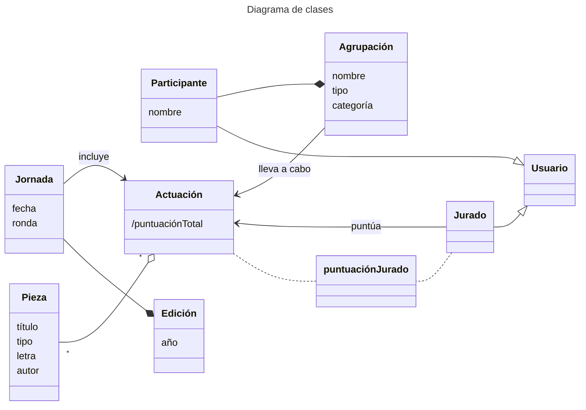

requisitos

## Requisitos funcionales
1. Consultar datos:
   - Agrupaciones
   - Piezas
   - Autores
   - Letras
   - Fechas
   - Resultados
2. Inscribir Agrupaciones
3. Sorteo de fechas
4. Gestión del jurado
5. Catalogación del archivo
6. Control de acceso

## Requisitos no funcionales
1. Uso de las tecnologías acordadas
2. Arquitectura modular
3. Mantenible por al menos 15 años
4. Software libre
5. Sostenibilidad documental
6. Cumplimiento de normativa:
   - Accesibildiad del sector público
   - LGPD
8. Gestión de datos sensibles
```mermaid
---
title: Diagrama de casos de uso
---
usecase-beta
    direction TD
    actor Usuario --> registrarAgrupacion("registrarAgrupación")
    Usuario --> consultarDatos
    Usuario --> iniciarSesion("iniciarSesión")
    Usuario --> registrarUsuario
    Usuario --> visualizarUsuario
    Usuario --> modificarUsuario
    Usuario --> eliminarUsuario
    actor Jurado --> puntua("puntúaActuación")
```
