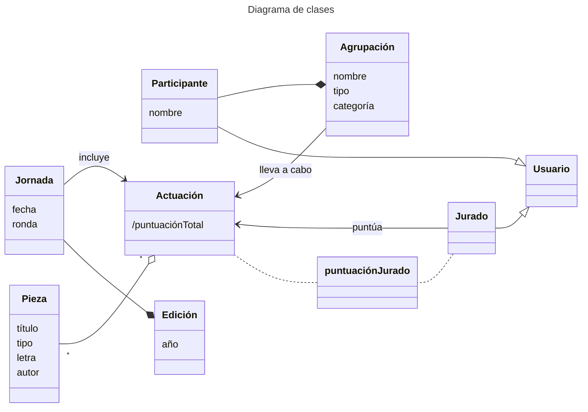

requisitos

## Propuesta de diagrama
```mermaid
title: Mejor? Diagrama de clases
classDiagram
    class Edicion {
        +int ano
        +String bases
        +boolean cerrada
    }

    class Jornada {
        +Date fecha
        +String fase
        +String ronda
    }

    class Actuacion {
        +int ordenActuacion
        +double puntuacionTotal
    }

    class Agrupacion {
        +String nombre
        +String modalidad
        +String categoria
        +String localidad
    }

    class Persona {
        +String nombre
        +String apellidos
        +String dni
    }

    class Componente {
        +String aniosParticipacion
    }

    class PiezaMusical {
        +String titulo
        +String tipo
        +String letra
        +String musica
    }

    class Jurado {
        +String tipoJurado
    }

    class PuntuacionJurado {
        +double nota
        +String observaciones
    }

    class Usuario {
        +String username
        +String passwordHash
        +String rol
    }

    %% Relaciones principales
    Edicion "1" --> "*" Jornada : convoca
    Jornada "1" --> "*" Actuacion : contiene
    Agrupacion "1" --> "*" Actuacion : realiza
    Actuacion "1" --> "*" PiezaMusical : interpreta
    
    %% Relación con el archivo histórico y ediciones
    Edicion "1" --> "*" Agrupacion : participa_en (inscripción)

    %% Personas y roles
    Persona "1" --> "*" Componente : es_componente
    Agrupacion "1" --> "*" Componente : agrupa_a
    Persona "1" --> "*" PiezaMusical : autoria
    
    %% Jurado y puntuaciones
    Jurado --|> Usuario : hereda_de
    Persona "1" --> "0..1" Jurado : ejerce_como
    Jurado "*" --> "*" PuntuacionJurado : emite
    Actuacion "1" --> "*" PuntuacionJurado : recibe
```
## Requisitos funcionales
1. Consultar datos:
   - Agrupaciones
   - Piezas
   - Autores
   - Letras
   - Fechas
   - Resultados
2. Inscribir Agrupaciones
3. Sorteo de fechas
4. Gestión del jurado
5. Catalogación del archivo
6. Control de acceso

## Requisitos no funcionales
1. Uso de las tecnologías acordadas
2. Arquitectura modular
3. Mantenible por al menos 15 años
4. Software libre
5. Sostenibilidad documental
6. Cumplimiento de normativa:
   - Accesibildiad del sector público
   - LGPD
8. Gestión de datos sensibles
```mermaid
---
title: Diagrama de casos de uso
---
usecase-beta
    direction TD
    actor Usuario --> registrarAgrupacion("registrarAgrupación")
    Usuario --> consultarDatos
    Usuario --> iniciarSesion("iniciarSesión")
    Usuario --> registrarUsuario
    Usuario --> visualizarUsuario
    Usuario --> modificarUsuario
    Usuario --> eliminarUsuario
    actor Jurado --> puntua("puntúaActuación")
```
