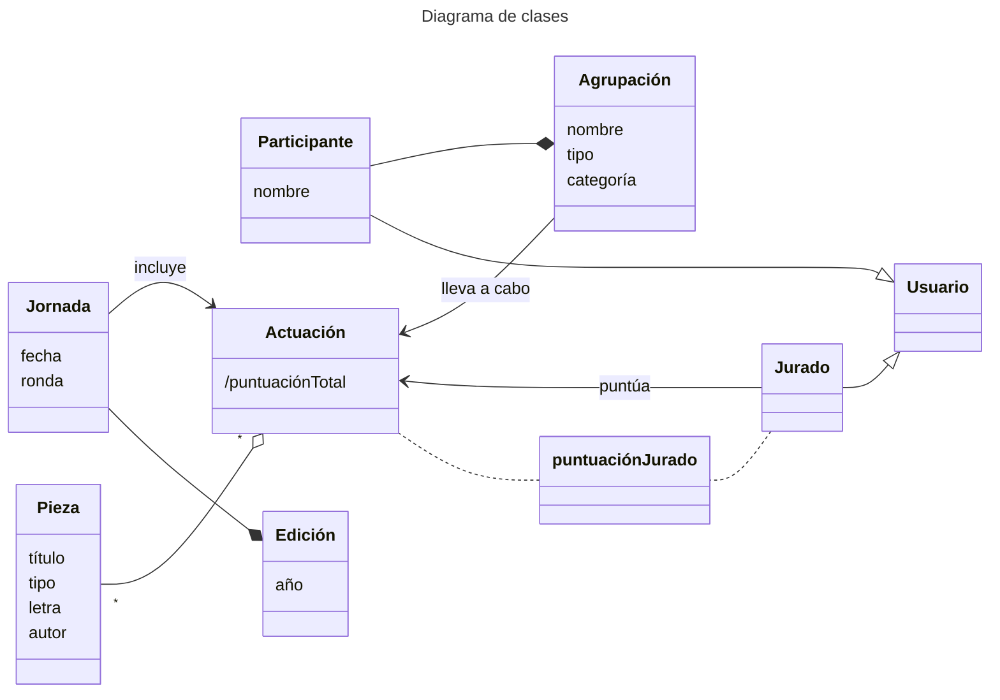
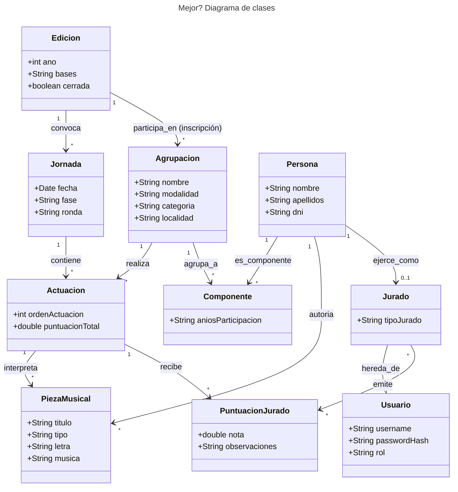

# Análisis de requisitos

## 1. Contexto y objetivos
El Ayuntamiento de Cádiz organiza anualmente el concurso oficial de agrupaciones del Carnaval(comparsas, chirigotas, coros y cuartetos). Las inscripciones, sorteos, fases y fallos del jurado se tramitan con formularios, hojas de cálculo y correo; las letras, autorías, componentes y premios previos
están dispersos en papel, archivos personales y webs de aficionados.

Por lo que el sitema debe:

| Objetivo | Descripción |
|---|---|
| **Gestión del concurso** | Inscripción, sorteo y fases de cada edición sin papel; resultados publicados con transparencia; menos carga para agrupaciones y personal municipal. |
| **Memoria del Carnaval** | Archivo de agrupaciones, autorías, letras y premios; cada edición cerrada se conserva íntegra; patrimonio abierto a aficionados e investigadores. |

Es un servicio público **de largo plazo**: debe seguir en servicio dentro de 15 años, mantenido por personas
que hoy no conocemos.

## 2. Actores

| Actor | Descripción | Acceso |
|---|---|---|
| Aficionado / investigador | Consulta el archivo y la edición en curso | Público, sin cuenta |
| Agrupación (responsable) | Tramita la inscripción, la fianza y los componentes de su agrupación | Rol `AGRUPACION` |
| Jurado | Registra las puntuaciones de las actuaciones | Rol `JURADO` |
| Personal municipal | Administra ediciones, sorteos, jurado, archivo y usuarios | Rol `MUNICIPAL` |
| Pasarela de pago *(sistema externo)* | Procesa la fianza | — |
| Sistema de notificaciones *(sistema externo)* | Envía avisos por correo | — |

## Requisitos funcionales
1. Consultar datos:
   - Agrupaciones
   - Piezas
   - Autores
   - Letras
   - Fechas
   - Resultados
2. Inscribir Agrupaciones
3. Sorteo de fechas
4. Gestión del jurado
5. Catalogación del archivo
6. Control de acceso

## Requisitos no funcionales
1. Uso de las tecnologías acordadas
2. Arquitectura modular
3. Mantenible por al menos 15 años
4. Software libre
5. Sostenibilidad documental
6. Cumplimiento de normativa:
   - Accesibildiad del sector público
   - LGPD


## Propuesta de diagrama


```mermaid
---
title: Diagrama de casos de uso
---
usecase-beta
    direction TD
    systemBoundary "Gestión de agrupación"
        crearAgrupacion("Crear Agrupación")
    end
    systemBoundary "Gestión de usuario"
        validarUsuario("Validar Usuario")
        crearUsuario("Crear Usuario")
        mostrarUsuario("Mostrar Usuario")
        modificarUsuario("Modificar Usuario")
        eliminarUsuario("Eliminar Usuario")
    end
    actor Usuario --> crearAgrupacion
    Usuario --> validarUsuario
    Usuario --> crearUsuario
    Usuario --> mostrarUsuario
    Usuario --> modificarUsuario
    Usuario --> eliminarUsuario
    actor Jurado --> puntua("Crear Puntuación")
```
